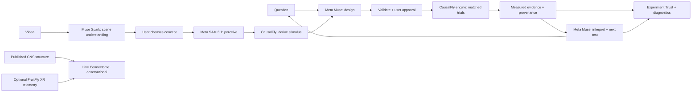

# CausalFly

**An AI-powered causal experiment workbench for simulated nervous systems.**

CausalFly turns a natural-language question into a controlled experiment: change one signal, compare control and intervention, inspect the measurements, and decide what to test next. It makes the path from an AI suggestion to measured evidence visible.

**Ask → Perceive → Design → Run → Measure → Understand → Test again**

**Meta Muse Spark** discovers trackable objects in a selected video. **Meta Muse Wonder** designs experiments, interprets measured evidence, and proposes the next test. **Meta SAM 3.1** segments and tracks visual input. **CausalFly** validates proposals, deterministically derives the stimulus, executes matched trials, and retains evidence and provenance.

> **AI proposes and interprets. CausalFly measures.**

Run the reliable offline demo with Node.js 22+ and npm (PowerShell):

```powershell
git clone https://github.com/Nurenyx/causalfly.git
Set-Location causalfly
npm ci
$env:CAUSALFLY_FAKE_META = '1'
npm run dev -- --hostname 127.0.0.1 --port 3000
```

Open **http://127.0.0.1:3000** → **Experiment** → **Design with Meta** → **Approve & Run Experiment** → **Explain with Meta**. Confirm **FAKE META CLIENT**: design and explanation are offline templates. To include perception offline, use **Real-world perception → choose the calibration video → Offline demo / validation → Load OFFLINE SCENE-UNDERSTANDING FIXTURE → select red square → Load OFFLINE SAM FIXTURE**. Discover with Meta and tracking with SAM are explicit live actions even in fake experiment-design mode.

[Demo runbook](docs/DEMO_RUNBOOK.md) · [3-minute video script](docs/DEMO_SCRIPT.md) · [Submission copy](docs/HACKATHON_SUBMISSION.md) · [Release review](docs/SPRINT_9_RELEASE_REVIEW.md)

## Problem and solution

An AI explanation alone cannot establish what an intervention changed. A useful experiment needs matched conditions, independent measurements, and a record of how the result was produced.

CausalFly connects those steps in one guided workbench. The controlled experiment uses a small, deterministic, synthetic two-pathway network. A user reviews the proposed design, approves the run, watches network and web embodiment playback, and inspects measured output differences before requesting interpretation. A proposed next test requires a new design and approval.

The second visual proof, **Live Connectome**, displays published Drosophila CNS structure with optional read-only FruitFly XR simulation telemetry. It is a separate observational path, not a controlled biological experiment.

## How Meta AI matters

| Layer | Responsibility |
| --- | --- |
| **Muse Spark** (`META_SCENE_MODEL`, example `muse-spark-1.3`) | Describe video and propose trackable objects; the user explicitly chooses a concept. |
| **Meta Muse** (`muse-wonder-1.0` in the supplied configuration) | Propose an experiment; interpret engine evidence; propose the next experiment. Optional FruitFly analysis interprets retained observational evidence on explicit request. |
| **Meta SAM 3.1** (`sam-3.1`) | Image/video object segmentation and tracking; this UI accepts short videos and retains perception input provenance. |
| **CausalFly** | Validate Meta output; select a returned track; compute visual features and stimulus deterministically; execute and measure control vs intervention; own evidence, provenance, trust checks, and the flight recorder. |

Requests are explicit. Selecting media, navigating, connecting telemetry, or loading a next question does not automatically call Meta. Live failures remain errors with recovery actions; they never silently become fake results. Credentials stay on the server. [Runtime details](docs/META-INTEGRATION.md) · [SAM pipeline](docs/sam-perception.md)

## Architecture



Next.js / React provide the workbench and server routes. TypeScript implements the synthetic engine, strict schemas, retained evidence, and process-local flight recorder. The OpenAI-compatible SDK transports Meta requests; official Meta SAM parser/player packages handle tracking output and playback. Three.js renders web embodiment and connectome views. [Detailed architecture](docs/ARCHITECTURE.md)

## Scientific trust boundary

- Both synthetic trials share network, engine, stimulus, seed, observation window, and threshold. Only the approved silencing intervention differs.
- Engine-issued results and provenance remain separate from validated AI interpretation. Structural validation cannot guarantee the truth of AI prose; compare it with the measurements.
- SAM geometry is **input provenance**, not causal evidence. Apparent box expansion maps to synthetic amplitude using `clamp(max(0, lastArea - firstArea) / 0.5, 0, 1)`; it is not calibrated distance, approach speed, or biological vision.
- **Experiment Trust** reports matched conditions, engine-owned measurements, and replay inputs. Diagnostics export a manifest and event ledger. Hashes identify snapshots; downloads are editable copies, not signed attestations. Replay inputs do not mean replay was verified.
- Controlled results are synthetic engineering results, not Drosophila findings. Live Connectome combines published structure with **simulated neural dynamics**, not recordings from a living fly. Biological validation is not established.

[Scientific constraints](docs/SCIENTIFIC-CONSTRAINTS.md) · [Flight-recorder semantics](docs/SPRINT_8C_REVIEW.md)

## Live Meta configuration

Use Node.js 22+ (locally verified on Node 24). From the repository root, create a local environment file only if one does not exist:

```powershell
if (!(Test-Path .env.local)) { Copy-Item .env.example .env.local }
```

Edit `.env.local` locally:

```dotenv
META_API_KEY=<your Meta API key>
META_BASE_URL=https://api.meta.ai/v1
META_MODEL=muse-wonder-1.0
META_TIMEOUT_MS=120000
```

Your Meta account must have access to the configured Muse model and `sam-3.1`. SAM uses the official Meta base URL and the same server key; it does not use `META_MODEL` as its model. Never commit `.env.local` or prefix credentials with `NEXT_PUBLIC_`.

```powershell
Remove-Item Env:CAUSALFLY_FAKE_META -ErrorAction SilentlyContinue
npm run dev -- --hostname 127.0.0.1 --port 3000
```

Confirm **META LIVE** before presenting live Muse results. Restart the server after changing modes/configuration. For stable playback after validation, build once with `npm run build`, then substitute `npm run start -- --hostname 127.0.0.1 --port 3000` for the dev command. Build may need internet access for Google fonts.

## SAM calibration demo

In **Experiment**, keep the question “What happens if I silence the primary pathway?” Select **Real-world perception**, choose [`public/perception-calibration.mp4`](public/perception-calibration.mp4), enter **red square**, then click **Analyze with SAM 3.1**.

The clip is generated calibration media, not recorded real-world footage. The prior live check returned **60 tracked frames** and amplitude **0.48755208333333333** (displayed **0.488**); a fresh provider response may differ. CausalFly computes the amplitude from the returned boxes; it does not hard-code the expected result. [Recorded check](docs/SPRINT_8B_REVIEW.md)

Choose **Design Experiment With This Stimulus**, review the design, then **Approve & Run Experiment**. Inspect the measured result, request **Explain with Meta**, show the proposed next question, and open **Experiment Trust → Run diagnostics → EXPORT RUN DIAGNOSTICS**. The [runbook](docs/DEMO_RUNBOOK.md) includes exact steps and recovery.

Offline perception instead uses a separate **four-frame geometry fixture**, amplitude **0.640**, with explicit fixture labels and no video analysis. `CAUSALFLY_FAKE_META=1` controls Muse only; use the fixture button to keep SAM offline.

## Optional FruitFly XR local integration

FruitFly XR / ConnectomeXR, its brain server, Quest embodiment, and published-connectome integration predate this hackathon. They are separate proprietary work and are not required for the synthetic experiment demo.

With an already-running local research service, configure the CausalFly server:

```powershell
$env:FRUITFLY_XR_OBSERVATORY_URL = 'ws://127.0.0.1:8766/observatory/v1'
npm run dev -- --hostname 127.0.0.1 --port 3000
```

Open **Live Connectome → Connect FruitFly XR**. The research subscription is read-only; it does not start a trial. An existing external organism client must provide a session for moving telemetry. Without it, show the bundled structural view and its waiting/disconnected state. CausalFly never sends interventions to the brain control channel. [Startup and recovery](docs/DEMO_RUNBOOK.md) · [Verified bridge protocol](docs/FRUITFLY-XR-BRIDGE.md)

## Validation

```powershell
npm test
npx tsc --noEmit
npm run lint
npm run build
git diff --check
```

Automated tests use fake/injected providers; no live SAM or Muse requests are needed. `npm run experiment:demo` runs the engine CLI; `npm run experiment:ai-demo -- --fake` runs the labelled offline AI workflow. The separate `meta:smoke` and `sam:smoke -- --live` commands are manual live requests, not acceptance tests.

## Limitations

The synthetic fixture is small and hand-authored; node labels do not establish biological identities. Web movement is an illustrative mapping of synthetic results. Perception uses a simple box-growth proxy affected by camera motion, occlusion, and track gaps. Video limits are 15 seconds, 20 MiB, 900 frames, and 1920 pixels per side; use H.264 MP4 for browser compatibility.

Workspace state and server retention are ephemeral; reloads, expiry, and restarts can require reanalysis and redesign. The local prototype has no authentication or durable/shared evidence store. Live provider access and latency depend on the account/network. FruitFly telemetry is bounded, may be truncated or dropped, and supports observational statements only. The interface is desktop-first.

## Hackathon disclosure and license

Built by Nurenyx for the **Meta Global AI Developer Hackathon 2026**, beginning October 26, 2026. CausalFly's repository, synthetic workflows, Meta integrations, web embodiment, guided flow, evidence surfaces, and trust layer were built during the event. Pre-existing FruitFly XR / ConnectomeXR work is disclosed separately. No proprietary FruitFly XR code or assets are added here. The existing anatomy JSON is a derived **public dataset** with separate attribution.

[Full hackathon disclosure](docs/HACKATHON-DISCLOSURE.md) · [Submission copy](docs/HACKATHON_SUBMISSION.md)

CausalFly code is **Apache-2.0**; see [LICENSE](LICENSE). The bundled published anatomy data retains **CC BY 4.0**; see [third-party notices and transformations](THIRD_PARTY_NOTICES.md). Dependencies retain their respective licenses. Copyright © 2026 Nurenyx.
