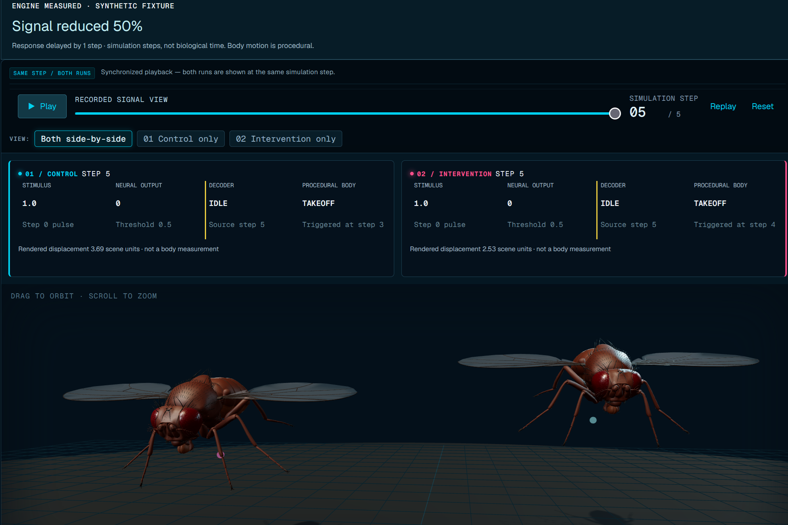
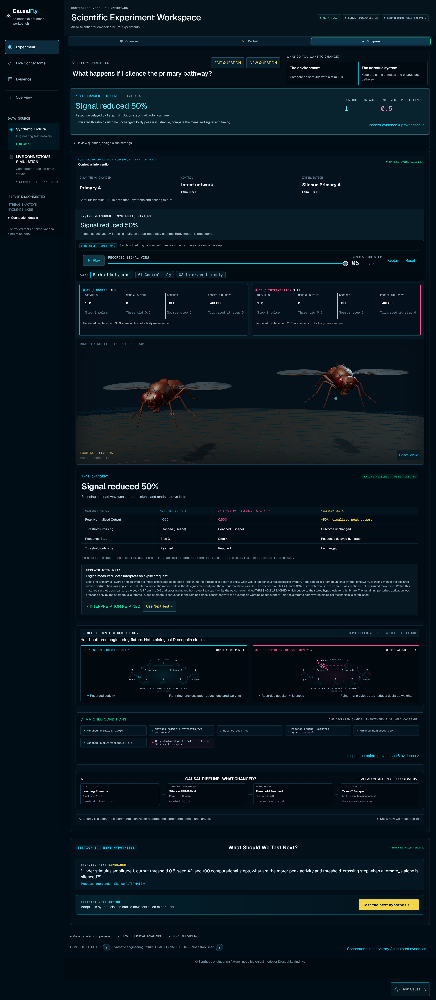
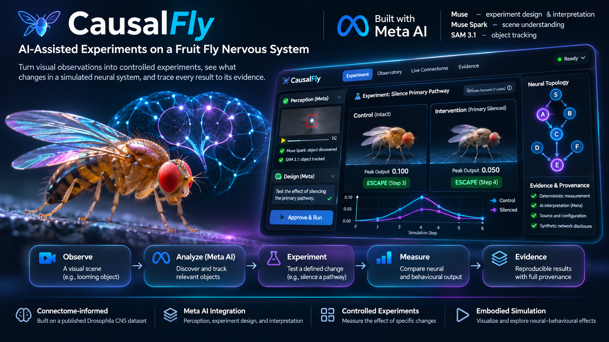
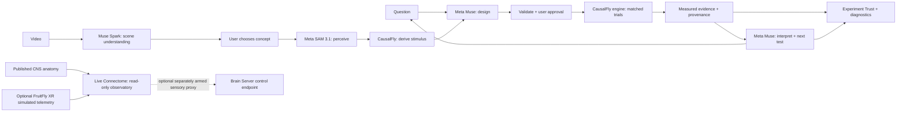

# CausalFly

**An AI-assisted experimental workbench for simulated nervous systems.**

**Ask a question. Test one change. See what actually changed.**

[Live Application](https://causalfly.nurenyx.ai) · [Watch the 3-Minute Demo](https://www.youtube.com/watch?v=dCPXuIaWth4) · [Scientific Foundation](https://research.google/blog/a-connectomics-milestone-mapping-the-complete-male-fruit-fly-brain/)



*Actual CausalFly Compare workspace: the intervention reduces the synthetic network's measured peak signal by 50% and delays the illustrated response by one **simulation step**, not biological time. The fly movement is procedural. These are not biological findings.*

CausalFly uses Meta AI to turn visual observations and natural-language questions into controlled experiments. A deterministic measurement engine compares outcomes, while interactive 3D visualizations and provenance records help users understand what changed and why.

**Ask → Perceive → Design → Run → Measure → Understand → Test again**

**Built with Meta AI**

- **Muse Spark:** Scene understanding and object discovery.
- **SAM 3.1:** Visual object tracking.
- **Muse:** Experiment design and interpretation.
- **CausalFly:** Experiment validation, deterministic measurement, evidence and provenance.

> **AI proposes and interprets. CausalFly measures.**

The controlled experiments use a **seven-node synthetic engineering network**. The separate Live Connectome workspace displays published Drosophila CNS anatomical data and optional external simulated neural activity. **Biological behavioural validation has not yet been established.**

### See the complete experiment

<details>

<summary>Expand the full CausalFly experiment workspace screenshot</summary>



</details>

## Problem and solution

An AI explanation alone cannot establish what an intervention changed. A useful experiment needs matched conditions, independent measurements, and a record of how the result was produced.

CausalFly connects those steps in one guided workbench. The controlled experiment uses a small, deterministic, synthetic two-pathway network. A user reviews the proposed design, approves the run, watches network and web embodiment playback, and inspects measured output differences before requesting interpretation. A proposed next test requires a new design and approval.

The separate **Live Connectome** workspace displays published Drosophila CNS anatomical data and can subscribe to read-only simulated telemetry from an optional external FruitFly XR service. An independent, opt-in experimental feedback control is available when configured. Neither the observational telemetry nor the feedback path constitutes a controlled biological experiment.

## Concept illustration

<details>
<summary>Expand an illustrative overview of the AI-assisted workflow</summary>



*Promotional concept artwork, **not a screenshot**. Its visualized UI and network are illustrative. Controlled results use the synthetic engineering model; published anatomy and external connectome simulation are separate capabilities.*

</details>

## Quick start — reproducible offline demo

The controlled synthetic experiment runs without Meta credentials or an external brain server. The offline AI client uses **explicitly labeled fixtures**, not live provider inference.

**Requirements:** Node.js 24 and npm.

```powershell
git clone https://github.com/Nurenyx/causalfly.git
Set-Location causalfly
npm ci
$env:CAUSALFLY_FAKE_META = '1'
npm run dev -- --hostname 127.0.0.1 --port 3132
```

Open http://127.0.0.1:3132 → **Experiment**. Design and approve a synthetic trial, compare its measured output, and inspect Evidence. To try the offline perception fixture, follow the explicit **Offline demo / validation** controls; these do not contact Muse Spark or SAM.

[Demo runbook](docs/DEMO_RUNBOOK.md) · [Hackathon disclosure](docs/HACKATHON-DISCLOSURE.md) · [Demo video](https://www.youtube.com/watch?v=dCPXuIaWth4)

## How Meta AI matters

| Layer | Responsibility |
| --- | --- |
| **Muse Spark** (`META_SCENE_MODEL`, example `muse-spark-1.3`) | Describe video and propose trackable objects; the user explicitly chooses a concept. |
| **Meta Muse** (`muse-wonder-1.0` in the supplied configuration) | Propose an experiment; interpret engine evidence; propose the next experiment. Optional FruitFly analysis interprets retained observational evidence on explicit request. |
| **Meta SAM 3.1** (`sam-3.1`) | Image/video object segmentation and tracking; this UI accepts short videos and retains perception input provenance. |
| **CausalFly** | Validate Meta output; select a returned track; compute visual features and stimulus deterministically; execute and measure control vs intervention; own evidence, provenance, trust checks, and the flight recorder. |

Requests are explicit. Selecting media, navigating, connecting telemetry, or loading a next question does not automatically call Meta. Live failures remain errors with recovery actions; they never silently become fake results. Credentials stay on the server. [Runtime details](docs/META-INTEGRATION.md) · [SAM pipeline](docs/sam-perception.md)

## Architecture



Next.js / React provide the workbench and server routes. TypeScript implements the synthetic engine, strict schemas, retained evidence, and process-local flight recorder. The OpenAI-compatible SDK transports Meta requests; official Meta SAM parser/player packages handle tracking output and playback. Three.js renders web embodiment and connectome views. [Detailed architecture](docs/ARCHITECTURE.md)

## Scientific foundation and data attribution

CausalFly's broader research context includes the published male *Drosophila melanogaster* central nervous system connectome, developed through research involving HHMI Janelia, the MRC Laboratory of Molecular Biology, Google Research, and collaborators.

The published reconstruction provides an anatomical resource for studying neural connectivity and sensory-to-motor circuits. It does not establish the physiological accuracy of CausalFly's simulated results.

**Primary sources:**

- [Google Research — A connectomics milestone: Mapping the complete male fruit fly brain](https://research.google/blog/a-connectomics-milestone-mapping-the-complete-male-fruit-fly-brain/)
- [Berg et al. (2026), *Sexual dimorphism in the complete Drosophila male central nervous system connectome*, *Cell*](https://doi.org/10.1016/j.cell.2026.08.015)
- [Janelia Male CNS Connectome Project](https://male-cns.janelia.org/)
- [Dataset attribution and third-party notices](THIRD_PARTY_NOTICES.md)

### How this research relates to CausalFly

CausalFly provides two distinct experimental and visualization layers:

1. **Synthetic controlled experiments:** A seven-node, hand-authored engineering network used to demonstrate deterministic interventions, measurements and comparisons.
2. **Live Connectome:** A separate visualization of published Drosophila CNS anatomy with optional telemetry from an external neural simulation service.

The controlled synthetic experiments do not simulate the complete published male CNS connectome.

Published anatomical connectivity does not, by itself, establish accurate neural dynamics or biological behaviour.

The associated FruitFly XR / ConnectomeXR research platform predates the Meta hackathon and is separately disclosed.

CausalFly is an independent Nurenyx project. The scientific references above do not imply endorsement by or affiliation with Google Research, HHMI Janelia, or the publishing institutions.

## Scientific trust boundary

- Matched trials share the same engine and controlled conditions. **Pathway-intervention experiments** hold stimulus and network fixed while changing the approved pathway state; **stimulus-response experiments** hold the network fixed while varying the specified stimulus. Matched-condition checks enforce the applicable comparison.
- Engine-issued results and provenance remain separate from schema-validated AI interpretation. Structural validation cannot guarantee the truth of AI prose; compare it with the measurements.
- SAM geometry is **input provenance**, not causal evidence. Apparent box expansion maps to synthetic amplitude using `clamp(max(0, lastArea - firstArea) / 0.5, 0, 1)`; it is not calibrated distance, approach speed, or biological vision.
- **Experiment Trust** reports matched conditions, engine-owned measurements, and replay inputs. Diagnostics export a manifest and event ledger. Hashes identify snapshots; downloads are editable copies, not signed attestations. Replay inputs do not mean replay was verified.
- Controlled results are synthetic engineering results, not Drosophila findings. Live Connectome combines published structure with **simulated neural dynamics**, not recordings from a living fly. Biological validation is not established.

[Scientific constraints](docs/SCIENTIFIC-CONSTRAINTS.md) · [Flight-recorder semantics](docs/SPRINT_8C_REVIEW.md)

## Live Meta configuration

Use Node.js 24 (locally verified on Node 24). From the repository root, create a local environment file only if one does not exist:

```powershell
if (!(Test-Path .env.local)) { Copy-Item .env.example .env.local }
```

Edit `.env.local` locally:

```dotenv
CAUSALFLY_META_ENABLED=1
META_API_KEY=<your Meta API key>
META_BASE_URL=https://api.meta.ai/v1
META_MODEL=muse-wonder-1.0
META_TIMEOUT_MS=120000
```

Your Meta account must have access to the configured Muse model and `sam-3.1`. SAM uses the official Meta base URL and the same server key; it does not use `META_MODEL` as its model. Never commit `.env.local` or prefix credentials with `NEXT_PUBLIC_`.

```powershell
Remove-Item Env:CAUSALFLY_FAKE_META -ErrorAction SilentlyContinue
npm run dev -- --hostname 127.0.0.1 --port 3132
```

Confirm **META LIVE** before presenting live Muse results. Restart the server after changing modes/configuration. For stable playback after validation, build once with `npm run build`, then substitute `npm run start -- --hostname 127.0.0.1 --port 3132` for the dev command. Build may need internet access for Google fonts.

### Meta enablement and developer diagnostics

Live experiment design requires `CAUSALFLY_META_ENABLED=1` and valid provider configuration. An unset or disabled switch returns a configuration-disabled response (HTTP 503), rather than masquerading as a provider outage. `CAUSALFLY_FAKE_META=1` explicitly selects offline templates without contacting Meta; live errors do not silently fall back to fixtures. Restart the local server after changing environment settings. Health checks report configuration status, **not** successful provider reachability.

Flight Recorder, scientific provenance, and human-readable Technical Details remain available. Raw diagnostic JSON export and raw event ledgers are hidden by default in production. On an internal deployment, `CAUSALFLY_DEVELOPER_DIAGNOSTICS=1` enables them; development exposes them by default unless this flag is `0`. **This switch is not authentication.** Diagnostic exports must never include credentials, provider headers/bodies, or signed media URLs.

Design failures use safe error codes such as `CONFIGURATION_DISABLED`, `CONFIGURATION_INVALID`, `AUTHENTICATION_FAILED`, `PROVIDER_TIMEOUT`, `PROVIDER_RATE_LIMIT`, `PROVIDER_HTTP_ERROR`, `INVALID_PROVIDER_RESPONSE`, `SCHEMA_VALIDATION_FAILED`, `REQUEST_CANCELLED`, and `UNKNOWN_PROVIDER_ERROR`. Provider output must pass strict schema validation before approval is available.

## SAM calibration demo

In **Experiment**, keep the question “What happens if I silence the primary pathway?” Select **Real-world perception**, choose [`public/perception-calibration.mp4`](public/perception-calibration.mp4), enter **red square**, then use **Discover with Meta**, confirm a candidate, and choose the explicit SAM tracking action. Live video requires the private Blob setup below.

The clip is generated calibration media, not recorded real-world footage. The prior live check returned **60 tracked frames** and amplitude **0.48755208333333333** (displayed **0.488**); a fresh provider response may differ. CausalFly computes the amplitude from the returned boxes; it does not hard-code the expected result. [Recorded check](docs/SPRINT_8B_REVIEW.md)

Choose **Design Experiment With This Stimulus**, review the design, then **Approve & Run Experiment**. Inspect the measured result, request **Explain with Meta**, show the proposed next question, and open **Experiment Trust → Run diagnostics → EXPORT RUN DIAGNOSTICS**. The [runbook](docs/DEMO_RUNBOOK.md) includes exact steps and recovery.

Offline perception instead uses a separate **four-frame geometry fixture**, amplitude **0.640**, with explicit fixture labels and no video analysis. `CAUSALFLY_FAKE_META=1` also blocks live scene/SAM requests and makes the primary perception buttons load explicitly labelled calibration/tracking fixtures. No Blob credentials are required for this path. `CAUSALFLY_META_ENABLED=0` (or unset) blocks every live provider entry point even when keys exist.

## Optional FruitFly XR local integration

The Live Connectome observatory subscription is read-only by default.

A separate, experimental, opt-in sensory-feedback feature may send bounded proxy stimulus messages to a configured external Brain Server control endpoint. This is not direct neuronal silencing and does not establish biological sensory equivalence.

The external Brain Server is optional for the synthetic experiment workflow. Public brain-control access should be authenticated or restricted before unsupervised use.

## Production alpha

CausalFly is deployed on Vercel at:

https://causalfly.nurenyx.ai

The synthetic experiment workflow runs independently of the optional external FruitFly XR Brain Server.

Live Meta features require configured provider access. Live video analysis uses private Vercel Blob storage with explicit upload authorization and application-level media limits.

See [Production Hardening](docs/SPRINT_11B_PRODUCTION_HARDENING_REVIEW.md) for deployment, storage, security, and operational considerations.

## Validation

```powershell
npm test
npx tsc --noEmit
npm run lint
npm run build
git diff --check
```

Automated tests use fake/injected providers; no live SAM or Muse requests are needed. `npm run experiment:demo` runs the engine CLI; `npm run experiment:ai-demo -- --fake` runs the labelled offline AI workflow. The separate `meta:smoke` and `sam:smoke -- --live` commands are manual live requests, not acceptance tests.

## Limitations

The application supports responsive mobile and desktop layouts. Recent acceptance testing covered screen widths from 320 to 1440 CSS pixels in Firefox and Edge. Complex scientific inspection and detailed comparisons may still be easier on larger screens.

The synthetic fixture is small and hand-authored; node labels do not establish biological identities. Web movement is an illustrative mapping of synthetic results. Perception uses a simple box-growth proxy affected by camera motion, occlusion, and track gaps. Video limits are 15 seconds, 20 MiB, 900 frames, and 1920 pixels per side; use H.264 MP4 for browser compatibility.

Workspace state and server retention are ephemeral; reloads, expiry, and restarts can require reanalysis and redesign. The prototype does not provide application-level authentication or a durable shared evidence store. Live provider access and latency depend on the account and network. FruitFly telemetry is bounded, may be truncated or dropped, and supports observational statements only.

## Hackathon disclosure and license

Built by Nurenyx for the **Meta Global AI Developer Hackathon 2026**, beginning October 26, 2026. CausalFly's repository, synthetic workflows, Meta integrations, web embodiment, guided flow, evidence surfaces, and trust layer were built during the event. Pre-existing FruitFly XR / ConnectomeXR work is disclosed separately. No proprietary FruitFly XR code or assets are added here. The existing anatomy JSON is a derived **public dataset** with separate attribution.

[Full hackathon disclosure](docs/HACKATHON-DISCLOSURE.md) · [Submission copy](docs/HACKATHON_SUBMISSION.md)

CausalFly code is **Apache-2.0**; see [LICENSE](LICENSE). The bundled published anatomy data retains **CC BY 4.0**; see [third-party notices and transformations](THIRD_PARTY_NOTICES.md). Dependencies retain their respective licenses. Copyright © 2026 Nurenyx.
