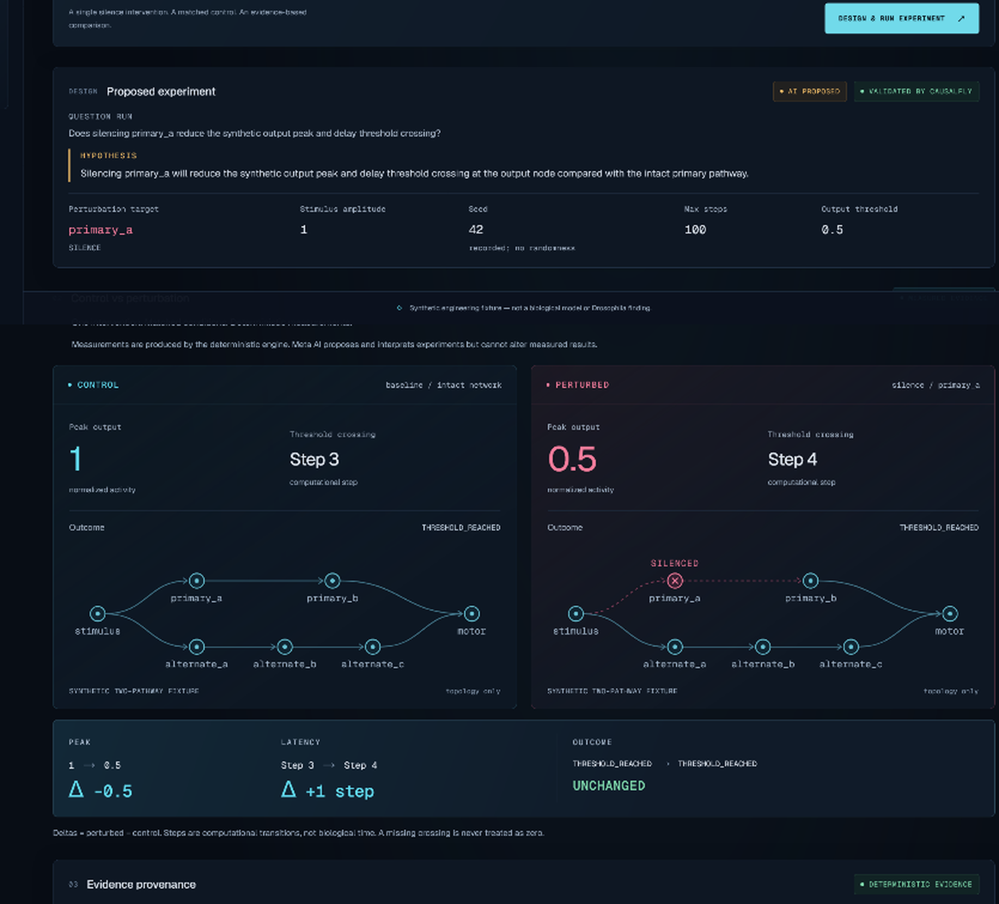
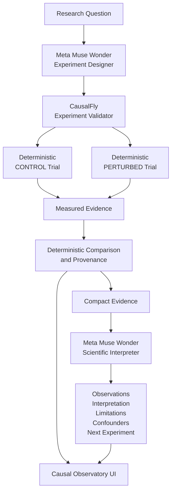

# CausalFly

**An AI-powered observatory for causal connectome experiments.**

CausalFly turns a research question into a controlled computational experiment:

**Ask a question → design an intervention → run matched control and perturbation trials → measure the difference → interpret the evidence → propose what to test next.**

Built for the **Meta Global AI Developer Hackathon 2026** by [Nurenyx](https://github.com/Nurenyx).

> **Trust boundary:** Meta AI proposes and interprets experiments. CausalFly's deterministic engine produces the measurements. AI-generated text cannot modify measured experimental results.

**Live Meta, two source-aware paths:** Synthetic Fixture runs Meta design → validated deterministic trials → Meta interpretation. FruitFly XR runs local observational analysis first, then **ANALYZE WITH META** sends the exact question and frozen retained evidence on demand. Accepted live results display **META MUSE / LIVE AI ANALYSIS**; errors allow Retry and never fall back to fake. [Runtime architecture and verification](docs/META-INTEGRATION.md).



---

## What CausalFly Does

A researcher begins with a question such as:

> Does silencing `primary_a` reduce the synthetic output peak and delay threshold crossing?

CausalFly then:

1. Sends the research question to **Meta Muse Wonder**.
2. Validates the returned experiment specification against deterministic guardrails.
3. Runs a matched **CONTROL** trial.
4. Applies the declared perturbation and runs a matched **PERTURBED** trial.
5. Calculates measured differences between the two conditions.
6. Preserves provenance for the experiment and evidence.
7. Sends compact measured evidence to Meta AI for downstream scientific interpretation.
8. Presents observations, interpretation, limitations, confounders, hypothesis support, and a proposed next experiment.

Controlled experiments use a **synthetic engineering network**. Sprint 5 also adds a separate, read-only **FruitFly XR** data source for connectome-backed simulation telemetry. Its Evidence view distinguishes published structural data from simulated dynamics; these are not recordings from a living fly. See the [verified protocol, limitations, and manual bridge test](docs/FRUITFLY-XR-BRIDGE.md).

---

## Why This Architecture Matters

Large language models can help formulate hypotheses and reason about experimental evidence, but the language model should not be the source of the measurement itself.

CausalFly therefore separates two responsibilities.

### AI layer

Meta AI may:

- translate a research question into an experiment proposal;
- select an eligible perturbation target;
- formulate a hypothesis;
- interpret measured evidence;
- identify limitations and confounders;
- propose the next experiment.

### Deterministic evidence layer

CausalFly alone:

- validates experiment parameters;
- executes control and perturbed trials;
- calculates output measurements;
- compares experimental conditions;
- records provenance;
- preserves the complete raw activity trace.

**The AI cannot rewrite a `TrialResult`, measured delta, or evidence provenance record.**

---

## Current Demonstration

The included synthetic network contains two pathways from a stimulus node to an output node:

```text
stimulus
├── primary_a ──> primary_b ───────────────┐
│                                           │
└── alternate_a ──> alternate_b ──> alternate_c
                                            │
                                            v
                                           motor
```

In the current demonstration, CausalFly can silence an eligible internal node and compare the result against an otherwise matched control.

Example measured output:

| Measurement | Control | Perturbed | Delta |
| --- | ---: | ---: | ---: |
| Peak output | 1.0 | 0.5 | -0.5 |
| Threshold crossing | Step 3 | Step 4 | +1 step |
| Outcome | Threshold reached | Threshold reached | Unchanged |

These values are produced by the deterministic engine. They are **not generated by Meta AI**.

---

## Scientific Evidence Boundary

CausalFly deliberately distinguishes between **measured evidence** and **AI interpretation**.

### Measured evidence

Produced deterministically by the experiment engine.

Examples include:

- peak output activity;
- threshold-crossing step;
- experimental outcome;
- perturbation target;
- control-versus-perturbation deltas;
- matched-condition provenance;
- activity traces.

### AI interpretation

Produced downstream from the measured evidence.

Examples include:

- observations;
- interpretation;
- limitations;
- possible confounders;
- whether the supplied evidence supports the stated hypothesis;
- the proposed next experiment.

The user interface keeps these categories visually separate.

### Experiment workspaces

- **Observatory** starts a research question and runs the existing scientific workflow.
- **Live Session** follows received FruitFly XR simulation ticks with spike-count charts, a sampled neuron-ID raster, decoder output, stream diagnostics, and deterministic session observations. It keeps up to 120 frames in memory, marks frames stale after five seconds, and preserves the last snapshot. It makes no Meta requests. See the [Sprint 5.1 review, telemetry map, screenshots, and manual procedure](docs/SPRINT_5_1_REVIEW.md).
- **Compare** opens automatically after a successful run. It pairs topology and activity charts with measured deltas, a propagation timeline, and an amber AI Scientist rail.
- **AI Scientist** preserves the complete observations, interpretation, limitations, confounders, hypothesis assessment, and proposed next experiment.
- **Evidence** exposes the accepted specification, matched-condition checks, engine/network provenance, and retained traces with raw versus retained sample counts.

“Use as Next Question” loads and focuses the Observatory input for review; it never submits automatically. Workspace state is in memory and resets on reload.

For a local offline visual review in PowerShell:

```powershell
$env:CAUSALFLY_FAKE_META='1'; npm run dev -- --hostname 127.0.0.1 --port 3104
```

Open `http://127.0.0.1:3104` and run an experiment to open Compare. Fake mode remains explicitly labelled even when live credentials are configured locally.

---

## Matched Experimental Conditions

For a valid control-versus-perturbation comparison, CausalFly verifies that both trials share:

- the same deterministic engine;
- the same network;
- the same experiment specification;
- the same stimulus;
- the same seed;
- the same observation window;
- the same output threshold.

Only the declared perturbation is allowed to differ.

---

## Evidence Compaction

The deterministic engine preserves the complete raw trial trace.

For downstream AI interpretation, CausalFly creates a compact evidence representation containing:

- every activity step containing non-zero activity;
- the first final quiescent step, when available;
- measured outputs;
- measured deltas;
- perturbation metadata;
- matched-condition provenance;
- the original observation-window length.

This reduces unnecessary model context while preserving the evidence required for interpretation.

The complete raw `TrialResult` remains available separately for provenance and debugging.

---

## Architecture



The critical boundary is between **AI reasoning** and **deterministic measurement**.

---

## Web Observatory

The CausalFly interface provides:

- a research-question workspace;
- AI-proposed experiment specifications;
- validated experiment parameters;
- side-by-side control and perturbation views;
- pathway visualization;
- measured deltas;
- deterministic provenance;
- AI Scientist analysis;
- limitations and confounders;
- a proposed next experiment;
- one-click loading of the next research question.

The current UI is desktop-first and optimized for scientific demonstration and review.

---

## Meta Model API

The live hackathon workflow has been tested with:

```text
META_MODEL=muse-wonder-1.0
META_BASE_URL=https://api.meta.ai/v1
```

Synthetic experiments use Meta AI in two distinct stages. FruitFly XR adds a separate on-demand observational scientist.

### 1. Experiment Designer

Input:

```text
Research question
```

Output:

```text
Validated ExperimentSpec
```

### 2. Scientific Interpreter

Input:

```text
Deterministically measured compact evidence
```

Output:

```text
ScientificAnalysis
```

Meta credentials remain server-side and are never sent to the browser.

### 3. FruitFly observational scientist

An explicit **ANALYZE WITH META** action sends the exact question plus compact,
validated, server-retained simulation evidence. Meta returns a strictly validated
observational interpretation, limitations and a proposed next test. No Meta call
occurs on navigation, connection, incoming telemetry or question submission alone.
Published connectome structure supports simulated dynamics—not living-fly
recordings or causal intervention claims. [Sprint 6A review](docs/SPRINT_6_META_RUNTIME_REVIEW.md).

---

## Getting Started

### Requirements

- Node.js compatible with Next.js 16
- npm
- Meta Model API credentials for live mode

The project has been tested locally with Node.js 24.

### Clone and install

```bash
git clone https://github.com/Nurenyx/causalfly.git
cd causalfly
npm install
```

---

## Environment Configuration

Copy the environment template.

### PowerShell

```powershell
Copy-Item .env.example .env.local
```

Configure `.env.local`:

```text
META_API_KEY=<your API key>
META_BASE_URL=https://api.meta.ai/v1
META_MODEL=muse-wonder-1.0
META_TIMEOUT_MS=120000
```

Never commit `.env.local`.

The repository's `.gitignore` excludes local environment files.

---

## Run with Live Meta AI

In PowerShell:

```powershell
Remove-Item Env:CAUSALFLY_FAKE_META -ErrorAction SilentlyContinue
npm run dev
```

Then open:

```text
http://localhost:3000
```

The interface should display:

```text
META LIVE
```

before a live experiment is submitted.

---

## Run Offline / Fake Meta Mode

The project includes a deterministic fake Meta client for development, testing, and UI demonstrations that do not require network access.

### PowerShell

```powershell
$env:CAUSALFLY_FAKE_META = "1"
npm run dev
```

The interface clearly displays:

```text
FAKE META CLIENT
```

Fake-mode output must never be presented as live Meta output.

---

## CLI Workflows

### Deterministic experiment

```bash
npm run experiment:demo
```

### AI experiment workflow

```bash
npm run experiment:ai-demo
```

When Meta configuration is available, the AI workflow can use the live Meta Model API.

### Full raw trial output

```bash
npm run experiment:ai-demo -- --raw
```

### Meta connectivity smoke test

```bash
npm run meta:smoke
```

Expected successful output:

```text
META LIVE
model: muse-wonder-1.0
status: ok
```

---

## Testing

Run the automated test suite:

```bash
npm test
```

Then verify linting and production compilation:

```bash
npm run lint
npm run build
git diff --check
```

Automated tests are designed to run without requiring live network access.

---

## Repository Structure

```text
src/
├── app/
│   ├── api/
│   │   └── experiments/
│   ├── observatory.tsx
│   └── ...
│
└── lib/
    ├── experiment/
    ├── meta/
    └── web/

scripts/
├── experiment-demo.ts
├── experiment-ai-demo.ts
├── meta-smoke.ts
└── load-environment.ts

docs/
├── ARCHITECTURE.md
├── HACKATHON-DISCLOSURE.md
├── META-INTEGRATION.md
└── SCIENTIFIC-CONSTRAINTS.md
```

---

## Scientific Scope and Limitations

The current CausalFly repository is an engineering and research prototype.

The included network is:

- synthetic;
- hand-authored;
- deterministic;
- intentionally small;
- not a biological connectome;
- not a model of Drosophila neural physiology.

Current results therefore **must not be interpreted as biological findings**.

The synthetic fixture exists to validate the causal-experiment architecture, evidence boundary, provenance model, and AI-assisted experimental workflow before connecting the system to biological simulation or experimental data.

---

## Future Direction

CausalFly is designed so that the evidence-producing layer can eventually be replaced or extended by other deterministic or empirical systems.

Potential future data sources include:

- connectome simulators;
- biological network models;
- imported experimental datasets;
- embodied simulation telemetry;
- XR research environments;
- robotic embodiments.

The current **FruitFly XR** integration is read-only and presents connectome-backed simulated telemetry in Live Session and Evidence. Future work may extend that boundary to controlled interventions and verified embodiment measurements.

---

## Hackathon Disclosure

CausalFly was created from scratch during the **Meta Global AI Developer Hackathon**, beginning October 26, 2026.

Nurenyx previously developed **FruitFly XR**, a separate Drosophila connectome simulation and mixed-reality research prototype.

**No FruitFly XR source code or Git history is included in this repository.**

CausalFly is a new open-source project focused on:

- AI-assisted causal experiment design;
- deterministic control-versus-perturbation execution;
- experiment provenance;
- evidence preservation;
- scientific interpretation;
- iterative hypothesis generation.

See [`docs/HACKATHON-DISCLOSURE.md`](docs/HACKATHON-DISCLOSURE.md) for the repository disclosure.

---

## Security

Sprint 8B adds optional **Real-world perception** inside Experiment: short video → Meta SAM 3.1 → deterministic visual-expansion measurement → explicit stimulus acceptance → approved matched runs → separate Muse interpretation. Synthetic remains the default. See [SAM perception architecture, mapping, limits, and offline/live validation](docs/sam-perception.md).

Never commit:

- `.env.local`;
- Meta API keys;
- Authorization headers;
- private provider request data.

Provider diagnostics intentionally redact sensitive configuration and request content.

If a credential is accidentally exposed, revoke it immediately and create a replacement key.

---

## License

CausalFly is licensed under the **Apache License 2.0**.

See [`LICENSE`](LICENSE).

Copyright © 2026 Nurenyx.
